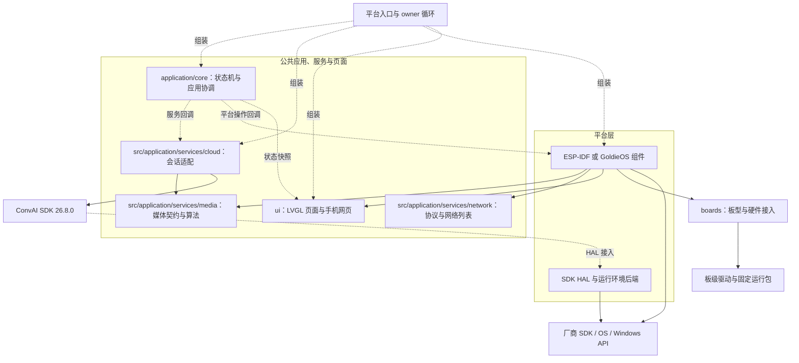
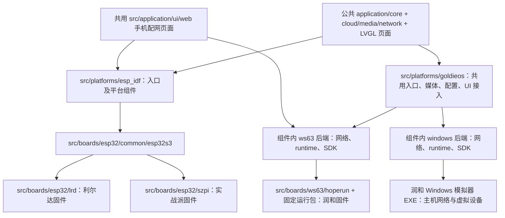
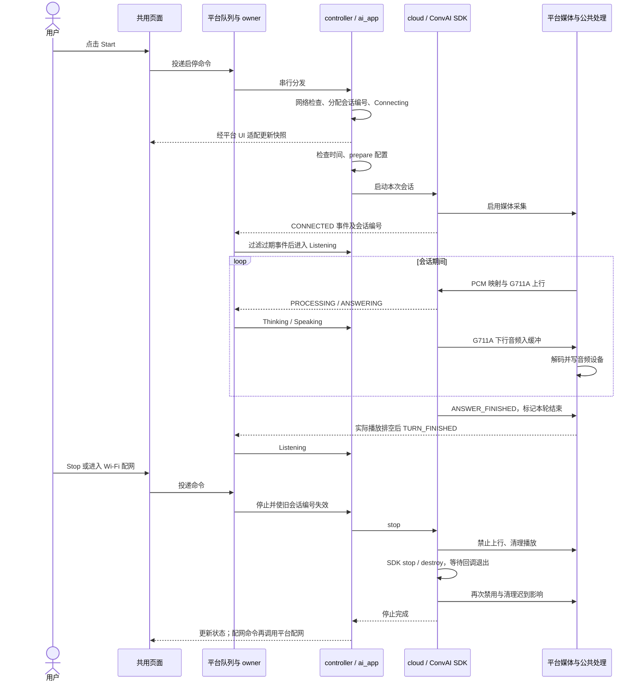
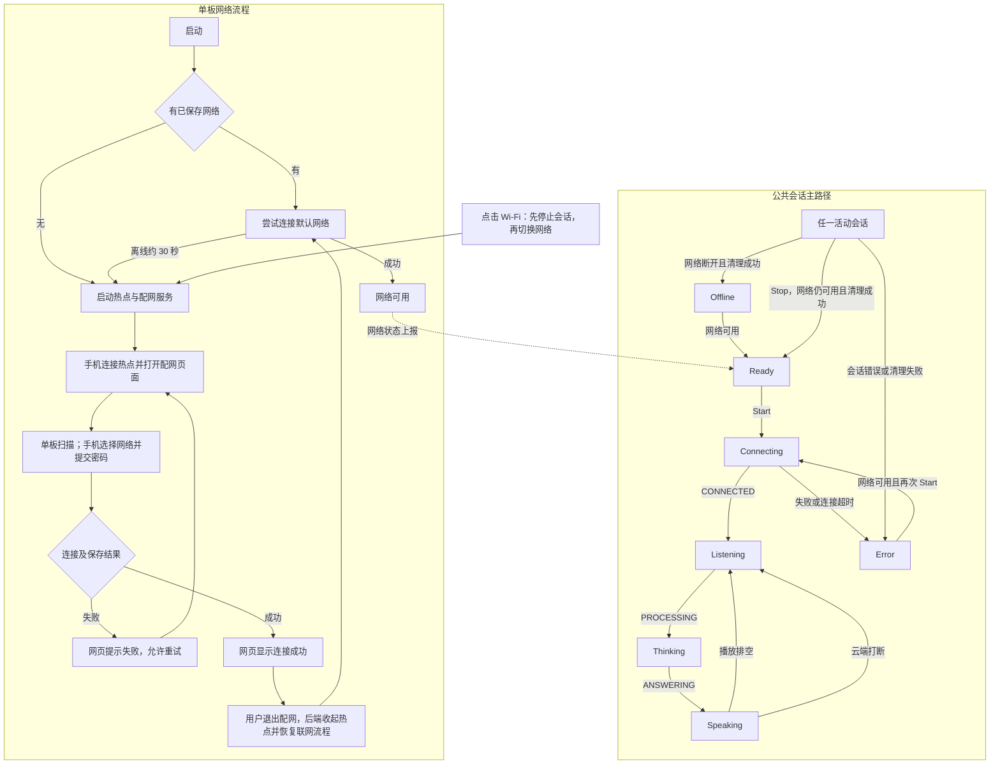

# Unified AI App 整体架构与业务流程

源码核对日期：2026-10-15。本文面向架构分享与后续 PPT 编写，描述当前实现，并单独标明验证边界、已知问题和规划。本文不修改运行代码，不代表新一轮构建或实机验收。

当前工程把三款单板的 AI 对话体验集中在公共应用、服务和页面中，由平台入口组装运行环境，由板级实现承接硬件差异。已支持利尔达 ESP32-S3、立创实战派 ESP32-S3、润和 WS63，以及润和 Windows 模拟器。平台复用并不意味着驱动、线程、网络实现完全相同。

## 1. 分享时先明确的边界

| 概念 | 当前含义 | 不能混用的概念 |
|---|---|---|
| 芯片平台 | ESP32-S3、WS63 | 芯片不等于操作系统或某个伙伴板型 |
| 软件平台后端 | ESP-IDF、当前 GoldieOS 集成 | GoldieOS 不代表所有 WS63 伙伴实现 |
| 运行环境 | ESP 实机、GoldieOS WS63 实机、GoldieOS Windows 主机环境 | Windows 模拟器不执行 WS63 固件 |
| 板型 | lrd、szpi、hoperun | 板型负责硬件配置，不拥有公共对话状态机 |
| 构建目标 | 三款固件与一个 EXE | 四目标构建成功不等于四目标最新版本均已实测 |

Windows 模拟器复用应用与页面，使用 Windows 网络和虚拟设备接入；不提供热点配网。它可以验证界面和对话集成，不能替代单板的无线、触摸、音频电路及性能验证。

## 2. 公共层、平台层与板级职责

| 层/目录 | 当前职责 | 边界 |
|---|---|---|
| `src/application/core/ai_app.c` | 会话状态、会话编号、启停、连接超时、过期事件过滤 | 不操作线程、GPIO、Wi-Fi 或 LVGL |
| `src/application/core/ai_controller.c` | 命令协调、时间就绪检查、每次启动准备、配网前停止会话、网络提示刷新 | 通过回调调用具体服务；由平台 owner 串行驱动 |
| `src/application/services/cloud/` | ConvAI SDK 生命周期、云事件转换、上下行媒体对接 | 依赖 SDK 公共接口及媒体契约，不直接调用硬件/UI |
| `src/application/services/media/` | 媒体操作契约、PCM 声道映射、G711A、播放缓冲逻辑 | 内存、锁、工作线程和设备读写由调用方提供 |
| `src/application/services/network/` | 配网协议工具、网络提示、保存网络列表操作 | 不直接控制无线接口；状态查询留在后端内部 |
| `src/application/ui/` | LVGL 布局、状态展示、启停/配网命令、共用手机网页 | 不拥有会话生命周期，不直接调用云 SDK |
| `src/platforms/*/entry/` | 组装依赖、初始化、事件队列、owner 循环 | 连接公共模块与平台实现，不承载板级驱动 |
| `src/platforms/*/components/` | 网络、媒体任务、配置、UI 接入、SDK HAL、运行环境适配 | ESP-IDF 与 GoldieOS 保持相近职责，但文件实现按后端需要组织 |
| `src/boards/esp32/` | 两板配置、引脚、屏幕/触摸、Codec 与音频布局 | `common/esp32s3` 仅为 ESP32-S3 共用，不是全平台公共层 |
| `src/boards/ws63/hoperun/` | 润和板级服务接入、显示传输、音频布局、BSP 选择 | 底层使用工程内固定 GoldieOS 运行归档；工具链单独准备 |
| `config/`、`third_party/` | 配置模板、锁定的 SDK/必要依赖 | 实际鉴权、生成配置、镜像和本地日志不作为普通源码提交 |

### 图 1：整体架构与依赖关系

实线表示主要编译/接口依赖，虚线表示入口组装或运行时回调接入。图刻意不画成“每层只能调用下一层”的直线：页面、云服务和媒体是协作模块，平台入口负责接线。

图中的媒体依赖是 `ai_media_ops_t` 等契约与公共处理能力，不表示公共 cloud 可以直接操作 I2S。平台媒体实现无需包含 cloud 生命周期头。UI 的屏幕适配也由平台/板级接线，公共页面不选择具体芯片。

## 3. 四目标复用方式

### 图 2：四目标代码复用图

| 目标 | 复用与差异 | 当前产物 |
|---|---|---|
| 利尔达 | ESP-IDF；板级引脚、触摸、Codec 地址、麦克风槽位等不同 | `build-lrd/unified_ai_lrd_merged.bin` |
| 实战派 | 复用 ESP 平台与 ESP32-S3 共用实现；另有 BOOT 启停输入 | `build-szpi/unified_ai_szpi_merged.bin` |
| 润和 WS63 | GoldieOS 服务 ABI、WS63 网络/运行时/SDK 后端、润和 BSP | `build-hoperun-app/out/unified_ai_hoperun.fwpkg` |
| 润和 Windows | 复用 GoldieOS 上层接入；替换主机后端，不提供配网按钮 | `build-hoperun-win/unified_ai_simulator.exe` |

ESP 两目标采用合并镜像，是将启动、分区与应用等烧写内容组合成便于烧写的文件，不是将两款板型合成一个运行程序。根 `CMakeLists.txt` 是轻量分发入口；ESP 工程配置在平台目录，原板型参数与产物名保留。

媒体统一的是契约和格式，不是硬件接线。ESP 采集交织槽位，板型选择麦克风/参考通道；润和实机与模拟器也有各自采集布局。公共转换生成麦克风与参考两个 G711A 平面；无参考通道时补零。该处理不等于新增本地 AEC 算法。

## 4. 启动、线程与事件所有权

平台入口组织设备/媒体、UI、SDK HAL、配置、公共 controller、网络与时间准备，具体初始化顺序受平台约束。例如 GoldieOS 在 UI 之前做媒体准备，避免设备接入时序破坏已有修复。不能仅为了代码外观一致强行合并初始化流程。

| 执行方 | 工作 | 与公共业务的连接 |
|---|---|---|
| 应用 owner | 处理命令与云事件、轮询网络、执行 tick | 串行修改 `ai_app` 状态 |
| SDK 回调 | 收到连接、识别/处理/回答状态及下行音频 | 状态事件入队；音频交给媒体契约 |
| 媒体工作线程 | 采集、上行、播放与播放完成检测 | 不直接修改页面或应用状态 |
| UI 执行线程 | 处理触摸、绘制页面 | 发命令；消费复制后的状态/文字 |
| 网络/时间后端 | 联网、热点、持久化、时间同步 | 提供平台操作与状态信息 |

当前 ESP 使用 FreeRTOS 队列，GoldieOS 使用本地互斥保护的环形队列，容量均为 32。公共 `ai_mailbox` 已整体回退，不应出现在当前架构图中。溢出后平台清理待处理消息，再由 controller 触发本地失败停止；这不等于已经解决所有并发边界问题。

`Ready` 表示应用观察到网络可用，不保证云连接、鉴权或时间同步全部成功。Start 前仍检查时间就绪并重新准备配置；命令处理返回成功也不等于云会话已经建立。

## 5. AI 对话业务流程

### 图 3：一次会话及停止流程

该图展示成功路径。Start 准备或 SDK 启动失败会转 Error 并执行清理。SDK 连接成功前，上行回调可返回“暂停发送”，不应把它等同于录音故障。

云端回答结束和扬声器播放结束是两个时点：先标记结束，待缓冲实际排空后才上报本轮完成。收到云端打断时清理旧播放并回到听取状态。会话编号过滤依赖 SDK 销毁/线程退出契约共同成立，不能只靠编号替代资源生命周期管理。

## 6. 联网、配网与会话状态

### 图 4：网络流程与会话状态协作图

网络流程与会话状态属于两个相关维度，下面分区展示；网络框不是 `ai_state_t` 的新增枚举。

图中 `Active` 是解释性入口，不是实际枚举。云状态事件可以从其他活动状态切换到 Listening/Thinking/Speaking，图只突出正常主路径。网络断开会停止会话；网络恢复不会自动重开对话。停止返回错误时显示 Error。

Connecting 有 30 秒超时检查，但由 owner 的 tick 驱动；若 SDK 调用阻塞 owner，不能把它解释为可强制中断的 30 秒硬期限。当前没有 Thinking 超时恢复机制。

### 配网链路和一致性边界

1. 三款单板保留启动自动联网/无网转热点，也保留 Wi-Fi 按钮。对话中点击 Wi-Fi，公共协调层先停止并回收会话，再交给后端配网。
2. 手机只是网页客户端。无线扫描、目标网络连接和保存均由单板执行；网页通过 HTTP 获取结果。
3. 自动弹页依赖 DHCP、DNS 和 HTTP 探测链路。润和保留 DHCP 网关选项兼容修复；“能手动打开 IP”并不能证明完整自动弹页链路正确。
4. 网络列表的添加/更新、删除、设默认由公共逻辑处理；持久化回调成功后才更新内存列表。ESP 用 NVS 双快照，润和用 NV，不依赖 SD 卡。
5. ESP 旧键只用于必要的首次迁移，保留但不再同步更新；降级旧固件可能看到旧网络列表。保存提交后回读失败也可能出现“报告失败但重启读到新值”。
6. 润和后端提供连接请求状态查询用于响应丢失后的恢复；不能据此声称 ESP 也实现了完全相同的 HTTP 请求恢复接口。
7. 润和提交密码不会直接关闭热点；退出配网是独立操作。首次配网偶发断连的根因仍待定位。

## 7. 当前状态：实现、验证、问题和规划

### 已实现

- 公共状态机与协调层、统一 LVGL 对话页面、手机配网页面、云会话适配与媒体契约。
- 三板平台/板级拆分、GoldieOS WS63/Windows 后端分离、根构建入口轻量分发。
- 公共网络列表操作、保存失败反馈、ESP 双快照、润和 NV 存储及此前必要网络/时间修复。
- 会话编号过滤、配网前停止、缓冲播放完成处理与连接超时。
- 第三批已精简未使用音频统计/清空接口；第四批公共邮箱已回退；媒体契约已移到媒体服务。

### 已验证及其范围

| 证据 | 能支持的结论 | 不支持的结论 |
|---|---|---|
| 最新媒体契约版本四目标构建成功 | 当前目标编译链接、产物生成通过 | 四个最新产物均通过运行验收 |
| 12/12 主机测试与架构检查通过 | 状态机、协调、媒体/网络/存储等被测契约及依赖规则通过 | 真实无线环境、音频电路和 RTOS 并发全部正确 |
| 历史三板用户验收 | 相应版本显示、配网、对话正常 | 可以跨版本继承验收或证明长期稳定 |
| 历史 Windows 用户验收 | 相应 EXE 界面和对话正常 | 当前最新 EXE 或实机硬件性能已验证 |
| 第三批润和用户验收 | 对应版本显示、对话、重复启停、对话中进入配网正常 | 首次配网偶发断连已修复 |
| 最新润和镜像已烧写 | 下载完成、镜像身份已核对 | 最新完整回归通过；用户已反馈下列会话问题 |

最新润和镜像 SHA-256：`c294492fdc6e5ad569f3d398b24fcfe96910804da00e937b5c5976374347a7a2`。其他产物哈希及历史版本见 [验证记录](validation.md)，分享时不要将不同轮次验收拼接为“最新四目标全部通过”。

### 已知问题与证据边界

| 问题 | 当前证据 | 处理状态 |
|---|---|---|
| 润和首次手机配网偶发断连，未收到成功提示 | 用户反馈屏幕无变化，重试通常不复现；尚无根因证据 | 按用户要求遗留，未修复 |
| 润和点击 Start 偶发 Error -7 | 用户反馈；SDK 网络错误与本地配置失败可能使用同一数值，界面码不足以定位 | 按用户要求后续定位 |
| 重连后偶发停在 Thinking | 日志出现发送队列满及停止等待超时，随后也有线程退出记录；尚不能建立完整因果链 | 未修复；现有实现没有 Thinking 超时恢复 |

不能把这些现象直接归因为 TLS、鉴权、死锁或手机型号，也不能把后续采集日志中的错误自动认定为每次界面故障的根因。

### 规划或暂缓项

| 项目 | 目前状态与边界 |
|---|---|
| 其他 WS63 伙伴 | 兼容当前服务 ABI 的板优先扩展 boards；不同 SDK/OS 服务体系仍需 ports 后端 |
| 树莓派/Linux | 预留公共契约复用方向，未实现 Linux 后端与板型 |
| Windows 主控硬件自动化 | 串口控制、持续日志、设备 ID 发现、多设备管理属于设计，尚未形成可用协议实现 |
| 一套用例跨硬件 | 能力声明、统一会话/测试协议、能力驱动跳过属于阶段 0 方案 |
| test/release 构建 | 产品测试入口与发布裁剪方案未落地；CMake Release 优化配置不等于该方案 |
| 数字音频注入、声学/显示夹具与性能门限 | 尚未实现，主机单元测试不等价于硬件自动化 |
| fbb_ws63 迁移、单板 LVGL 配网 | 已讨论，按用户要求暂缓 |
| Android/iOS/原生 Windows 多语言生态 | 当前不纳入实施范围；现有模拟器保留 |

## 8. 后续扩展应该改哪里

新增同平台板型时，先确认屏幕/触摸、音频布局、存储和 SDK ABI 是否兼容，再添加板级实现及构建选择。不要为每块板复制应用状态机、网页或云会话代码。

新增 WS63 软件体系时，保留公共 src/application/core、src/application/services、src/application/ui，建立必要的网络、媒体、运行时、配置和 SDK 接入；不要因为芯片同为 WS63，就让新伙伴依赖润和专属服务。板级改动能否覆盖全部适配取决于后端兼容性。

新增树莓派时可按同样职责建立 Linux 后端，承接线程、音频设备、网络与 SDK；板型负责外设选择与音频/屏幕配置。当前没有落实这些代码，也没有为了规划加入空实现。

自动化测试未来应通过独立传输适配进入公共命令路径，状态/事件从明确契约导出。串口控制与日志由同一个连接所有者复用，设备发现读取稳定设备 ID；不要让用例直接依赖 COM 号、板名或页面文案。此处是设计约束，具体协议以阶段 0 文档为起点继续确认。

## 9. 14 页 PPT 分享提纲

| 页 | 标题 | 主要内容/讲述重点 | 建议素材 |
|---|---|---|---|
| 1 | 一套 AI 应用适配多个生态硬件 | 三板与一个模拟器；目标是复用业务和体验 | 四目标名称与应用截图，截图后续补充 |
| 2 | 从独立示例走向公共应用 | 原有差异、最小功能范围、当前不包含的产品能力 | 功能范围与改造前后职责对照 |
| 3 | 平台、运行环境、板型如何区分 | ESP-IDF/GoldieOS 与 ESP32-S3/WS63 的不同维度 | 第 1 节概念表 |
| 4 | 总体架构 | 公共层、平台层、板级；组装与依赖分开 | 图 1 |
| 5 | 公共代码负责什么 | 状态机、协调、云、媒体、网络、页面 | 第 2 节职责表精简版 |
| 6 | 四目标如何复用 | 两板共享 ESP 后端；GoldieOS 分实机与 Windows 后端 | 图 2 |
| 7 | 启动与线程所有权 | 谁修改状态、谁收事件、谁画页面；平台队列保留 | 第 4 节执行方表 |
| 8 | 一次 AI 对话如何运行 | Start、连接、采集上行、Thinking、下行播放 | 图 3 上半部分 |
| 9 | 停止、打断与重复启停 | 会话编号、停止屏障、播放排空、配网前回收 | 图 3 下半部分及限制说明 |
| 10 | 联网与手机配网 | 自动联网、热点、单板扫描、保存、退出；与会话协调 | 图 4 |
| 11 | 本轮整改保留了什么 | 组件依赖、板级隔离、公共协调、媒体契约；删掉过度抽象 | 已实现项与邮箱回退说明 |
| 12 | 验证进展与已知问题 | 构建/主机测试/历史验收分开；-7、Thinking、首次配网问题 | 第 7 节状态表 |
| 13 | 如何支持新伙伴和树莓派 | 同后端加板型、异后端补平台；复用边界 | 第 8 节扩展步骤 |
| 14 | 下一阶段与需要确认的事项 | 故障闭环、四目标回归、统一测试契约、test/release 逐步落地 | 规划表；明确全部为待实施 |

建议讲述主线为“业务统一 → 差异隔离 → 流程与生命周期 → 验证边界 → 扩展”。性能、代码复用率和稳定性没有本轮测量数据，不填估算百分比或虚构指标。正式制作 PPT 时，可用真实四目标页面与构建/验证证据补充，不以截图替代版本记录。

## 10. 源码与文档阅读入口

| 阅读问题 | 入口 |
|---|---|
| 会话状态与公共协调 | [ai_app.c](../src/application/core/ai_app.c)、[ai_controller.c](../src/application/core/ai_controller.c) |
| 云会话生命周期 | [ai_cloud.c](../src/application/services/cloud/ai_cloud.c) |
| 媒体契约与播放 | [ai_media.h](../src/application/services/media/include/ai_media.h)、[ai_playback.c](../src/application/services/media/ai_playback.c) |
| 公共网络列表 | [ai_wifi_store.c](../src/application/services/network/ai_wifi_store.c) |
| ESP 入口与实际媒体任务 | [app_main.c](../src/platforms/esp_idf/entry/app_main.c)、[media.c](../src/platforms/esp_idf/components/media/media.c) |
| GoldieOS 入口与实际媒体任务 | [app.c](../src/platforms/goldieos/entry/app.c)、[media.c](../src/platforms/goldieos/components/media/media.c) |
| 润和联网后端 | [network.c](../src/platforms/goldieos/components/network/ws63/network.c) |
| 公共页面 | [ai_lvgl.c](../src/application/ui/ai_lvgl.c)、[wifi_configuration.html](../src/application/ui/web/wifi_configuration.html) |
| 架构细节、测试规划 | [架构说明](architecture.md)、[阶段 0 契约](stage0-contracts.md) |
| 板级差异、验收、提交范围 | [板型对比](board-comparison.md)、[验证记录](validation.md)、[上库清单](repository-guide.md) |

本文随 src/application/core、src/platforms 和 convai 目录迁移更新源码入口；本轮构建证据及逐文件变更见 [src 迁移记录](changes-src-layout-2026-10-15.md)。未制作 PPT。
