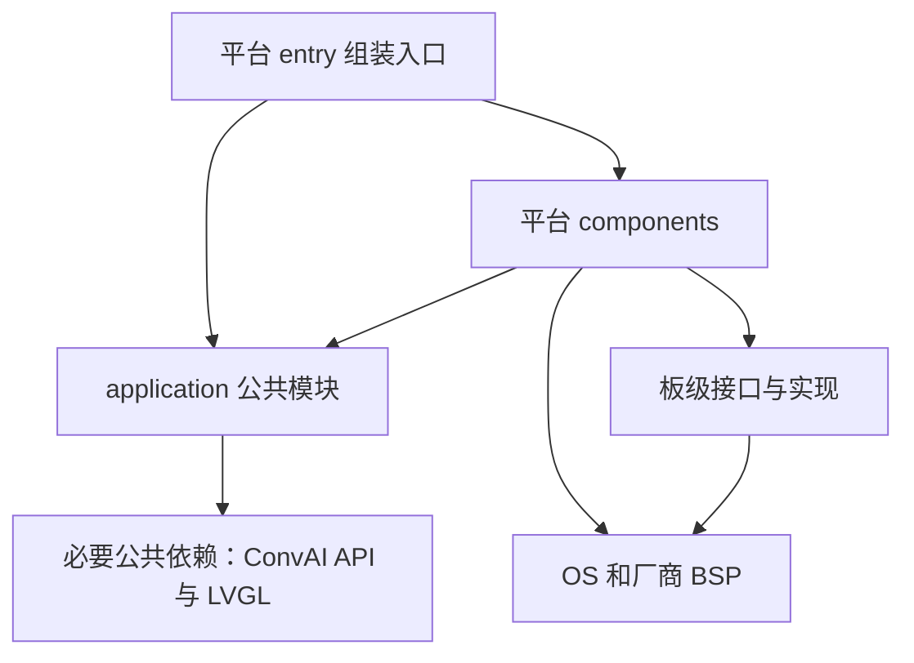

# 第 1 步：目录结构与分层职责

[培训索引](README.md) · [下一步：构建与启动](02-build-and-startup.md)

## 1. 学习目标

读完本节，应能判断一段代码属于公共应用、平台适配还是板级实现；能解释为什么公共云服务最终可以调用平台播放函数，却不需要包含平台头文件。

先记住：`application` 定义产品行为，`platforms` 连接软件运行环境，`boards` 描述具体硬件差异。平台入口负责组装。

## 2. 从工程根目录进入

```text
unified-app/
├── src/
│   ├── application/   公共业务、服务与页面
│   ├── platforms/     平台入口、组件、SDK HAL、构建适配
│   └── boards/        板级接口与具体板卡实现
├── config/           构建默认值、分区与私人配置模板
├── third_party/      ConvAI SDK、LVGL 等外部依赖
├── tests/            主机测试与测试替身
├── tools/            架构检查、清单更新
├── skills/           构建操作说明和辅助脚本
├── docs/             设计、培训、验证与上库资料
├── CMakeLists.txt    轻量目标分发
└── build-*/          本地产物，不上库
```

`src` 并不意味着“编译所需的全部源码”。外部库在 `third_party`，润和必要运行依赖已固定归档在 third_party，编译工具另行准备。不能只复制 `src` 就期待构建成功。`tools` 是工程辅助工具，不是烧写到单板上的产品模块。

根 [CMakeLists.txt](../../CMakeLists.txt) 选择 `esp32s3`、`goldieos_ws63` 或 `goldieos_windows`；详细构建逻辑由平台目录承担。

## 3. 公共应用层：产品应该怎样工作

```text
src/application/
├── core/                 ai_app.c、ai_controller.c、公开头文件
├── services/
│   ├── cloud/            ConvAI 会话接入与回调转换
│   ├── media/            音频契约、编解码、播放队列
│   └── network/          配网协议、网络列表操作与状态文字
└── ui/                   LVGL 公共页面、手机网页、界面契约
```

| 需求 | 应阅读的位置 | 为什么属于公共部分 |
|---|---|---|
| Start 后进入 Connecting | [ai_app.c](../../src/application/core/ai_app.c) | 各板应遵循同样的状态规则 |
| 配网前先停止对话 | [ai_controller.c](../../src/application/core/ai_controller.c) | 这是产品流程，与芯片无关 |
| 把 SDK 状态转换成应用事件 | [ai_cloud.c](../../src/application/services/cloud/ai_cloud.c) | 当前所有目标使用同一套 ConvAI 接入 |
| G711A 编码和队列预缓冲 | [ai_audio.c](../../src/application/services/media/ai_audio.c)、[ai_playback.c](../../src/application/services/media/ai_playback.c) | 算法不需要知道 GPIO 或 RTOS |
| 删除已保存网络 | [ai_wifi_store.c](../../src/application/services/network/ai_wifi_store.c) | 列表变换规则一致，介质写入由后端提供 |
| 按钮与状态标签布局 | [ai_lvgl.c](../../src/application/ui/ai_lvgl.c) | 统一三板及模拟器的界面设计 |

“公共”有具体边界：core 不依赖 OS、SDK 和 GUI；cloud 依赖 ConvAI 公共 API；公共 UI 依赖 LVGL。它们共同不直接依赖 ESP-IDF、GoldieOS、Windows API 或具体板型。当前没有实现任意云厂商自动互换的框架。

## 4. 平台层：产品能力如何在系统上运行

平台按实际软件接口体系命名：ESP-IDF 与 GoldieOS。`esp32s3` 是芯片型号，`hoperun` 是伙伴板型，不能代替软件平台身份。

| 子目录 | 责任 | 实际例子 |
|---|---|---|
| `entry` | 初始化并连接各模块，维护事件循环 | ESP `app_main`、GoldieOS `app_task` |
| `components/config` | 组装云配置、设备身份等 | 将构建配置转换成公共云服务需要的数据 |
| `components/media` | 创建任务、同步并操作音频设备 | FreeRTOS 锁或 GoldieOS mutex，音频读写 |
| `components/network` | 网络接口、热点、服务端及存储后端 | ESP Wi-Fi/NVS，WS63 WLAN/NV |
| `components/ui` | UI 运行环境、显示输入接入、线程安全更新 | LVGL 任务、显示刷新回调、触摸事件 |
| `components/convai` | SDK 所需的 OS/网络/TLS 适配 | socket、线程、时钟、TLS 读写 |
| `components/runtime` | GoldieOS 运行环境接入 | 等待驱动、校时、注册 SDK HAL |
| `targets`、`cmake` | 构建目标和组件注册 | 选择 WS63 或 Windows 后端 |

ESP 当前没有独立 `runtime` 模块；不为了目录对称而假设它存在。参阅[平台模块表](../../src/platforms/README.md)。

公共与平台的 `media/network/ui` 同名，是按同一能力拆分不同责任。例如公共 UI 决定按钮位置，平台 UI 决定在哪个线程运行 LVGL、如何刷新屏幕。

GoldieOS Windows 模拟器仍复用 GoldieOS 服务接口，因此位于该平台之下。它不是当前已实现的原生 Windows 平台。

## 5. 板级层：具体硬件怎样连接

```text
src/boards/
├── include/              board.h、ws_board.h
├── esp32/
│   ├── common/esp32s3/   当前两款 ESP32-S3 板共用的板级代码
│   ├── lrd/             利尔达
│   └── szpi/            立创实战派
└── ws63/hoperun/         润和板级代码
```

例如，[利尔达 profile.c](../../src/boards/esp32/lrd/profile.c) 提供采集通道及功放、触摸复位操作；[润和 board.c](../../src/boards/ws63/hoperun/board.c) 提供电源保持和音频布局；润和显示传输在 [display.c](../../src/boards/ws63/hoperun/display.c)。

“播放回答”属于业务及媒体链路；“将这块板的功放使能引脚置位”属于板级操作。板级实现可以使用厂商驱动和 OS，但公开板级头文件不暴露平台服务类型。

不要把当前 `boards` 理解成覆盖所有驱动：GoldieOS 媒体直接使用 BSP 的 `AudioService`，板级主要补充布局和生命周期差异。`board.h` 与 `ws_board.h` 也还不是统一的跨平台板级 API。

## 6. 依赖方向与运行方向

下图是简化的源码使用关系，省略标准库及少量公共常量依赖，不表示执行先后。



核心约束：公共业务不包含平台/板卡头文件；平台实现使用公共契约；平台入口选择并组装实现。不是要求所有调用只能沿着目录从上往下走。

在 [ai_media.h](../../src/application/services/media/include/ai_media.h) 中，`ai_media_ops_t` 定义 enable、reset、push、finish 函数指针。公共 cloud 只调用这张能力表，不直接调用 `ws_media_*` 或 `esp_media_*`。

ESP 入口实际组装片段：

```c
ai_cloud_config_t config = {.media = esp_media_ops(), .post = post};
```

GoldieOS 入口实际组装片段：

```c
ai_cloud_config_t cfg = {.media = ws_media_ops(), .post = ws_post};
```

所以运行时可以沿着 `SDK → ai_cloud → media.push → 平台媒体 → 设备` 调用。公共模块仍只依赖公共契约。这个做法称为静态依赖注入：启动时连接已有实现，不需要动态插件系统。

## 7. 按顺序打开这些文件

1. [ai_app.h](../../src/application/core/include/ai_app.h)：只关注状态和 ops。
2. [ai_media.h](../../src/application/services/media/include/ai_media.h)：看四个媒体操作。
3. [ESP 入口](../../src/platforms/esp_idf/entry/app_main.c)：找到 prepare 和 ops 初始化。
4. [GoldieOS 入口](../../src/platforms/goldieos/entry/app.c)：找到同样的组装方式。
5. [板级契约](../../src/boards/ws63/include/ws_board.h)：看它是否暴露云会话或 GUI 类型。
6. [架构检查](../../tools/check_architecture.py)：看哪些 include 被禁止。

检查器是可执行的部分边界规则，不是形式化证明；通过检查不代表线程时序和全部依赖都正确。

## 8. 练习与参考答案

先独立决定下列改动应放在哪里：修改 Thinking 文案；更换功放控制引脚；替换 TLS 实现；修改配网前停止对话的顺序；更换内部保存介质。

参考答案：文案查看公共状态命名/页面；功放在板级；TLS 在平台 convai；停止顺序在公共 controller；介质写入在平台存储后端。公共网络列表操作通常无需随介质变化。

自测：为什么 `ai_cloud.c` 运行时调用到了 GoldieOS 函数，却不需要 `#include "goldie_osal.h"`？因为它通过公共媒体接口调用由平台入口注入的函数指针。
