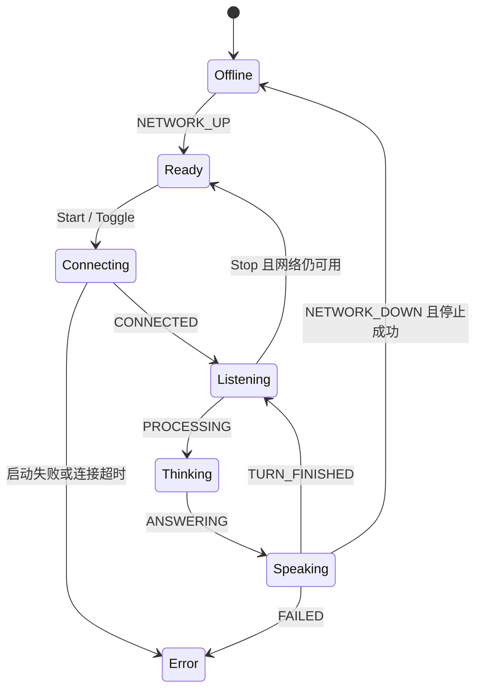

# 第 3 步：公共状态机与应用协调

[培训索引](README.md) · [上一步](02-build-and-startup.md) · [下一步](04-session-and-ui.md)

## 1. 学习目标与阅读入口

本节先不看网络和音频驱动。只回答：应用现在处于什么状态？收到一个事件后应做什么？谁负责统一处理这些事件？

阅读顺序：[ai_app.h](../../src/application/core/include/ai_app.h) → [ai_app.c](../../src/application/core/ai_app.c) → [ai_controller.h](../../src/application/core/include/ai_controller.h) → [ai_controller.c](../../src/application/core/ai_controller.c)。

`ai_app` 管理状态转换，`ai_controller` 组合应用级前置条件和工作流程。两者都不创建线程，不主动扫描 Wi-Fi，也不直接调用 LVGL。

## 2. 先区分五类数据

| 类型 | 含义 | 示例 |
|---|---|---|
| `ai_state_t` | 当前应用状态 | `AI_LISTENING` |
| `ai_event_t` | 已发生、要交给状态机处理的事情 | 网络断开、SDK 已连接、播放结束 |
| `ai_command_t` | 用户或其他入口要求应用执行的动作 | Start、Stop、Provision |
| `ai_message_t` | 跨线程队列里统一携带的消息 | kind 决定数据是 command 还是 event |
| `ai_view_t` | 提供给界面的状态快照 | state、network_up、active、error |

命令不等于已完成事件。Start 命令发出，不代表云端已经连接；Wi-Fi 按钮被点击，也不代表热点已经建立。

`active` 表示当前应用会话是否处于活动生命周期，不代表扬声器正在出声。`network_up` 是平台报告的网络可用条件，不保证服务器或 TLS 一定成功。

## 3. 状态如何变化

下面是常见正常路径，实际还允许打断、断网和其他 SDK 状态事件。



图没有穷举全部边。例如 `AI_HEARING` 也会进入 Listening；SDK 事件并不被强制检查为某一条唯一前驱路径；Stop 返回错误时可能落入 Error。阅读 switch 才能确认完整规则。

| 输入 | 当前实现的关键行为 |
|---|---|
| NETWORK_UP | 设置 network_up；只有不活动且当前 Offline 才自动变 Ready |
| NETWORK_DOWN | 清除 network_up，停止活动会话 |
| START | 已活动时直接返回；不把 Start 当 Toggle |
| TOGGLE | 活动则停止；不活动且有网络则尝试开始 |
| CONNECTED / HEARING / TURN_FINISHED | 对有效当前会话设置 Listening |
| PROCESSING / ANSWERING | 对有效当前会话设置 Thinking / Speaking |
| FAILED / DISCONNECTED / LOCAL_FAILED | 停止并显示错误 |

Error 状态下网络恢复，不保证立刻变 Ready；代码允许用户在有网络时再次 Start，重新清理 error 并尝试会话。

## 4. 回调接口让状态机保持简单

`ai_app_ops_t` 只有 ctx、start、stop、render。状态机知道“应该开始/停止”，但不知道实际操作需要哪个 SDK 或操作系统。

调用 start 前，状态机会更新 session、active、Connecting 和连接开始时间，并先 render。这样在 start 调用比较慢时，UI 仍有机会获取 Connecting 快照；实际显示还依赖 UI 线程运行。

`ai_app_tick` 在 Connecting 持续达到 30000 ms 时停止并报 -2。它是 owner 循环里的检查，不是独立看门狗；若 owner 被同步操作长时间阻塞，tick 也无法准时执行。

计时使用无符号差值 `(uint32_t)(now - since)`，避免单次 32 位计时器回绕造成简单的时间倒退判断。它不是任意长时间跨度的万能计时方案。

## 5. session：挡住上一轮迟到的消息

每次开始新会话和执行 stop，状态机都会推进 session。SDK 类事件必须携带对应 session；当应用不活动或编号不一致时，它们被丢弃。

例如：

```text
第一次 Start：session = 1
上一轮 SDK 已把 ANSWERING(session=1) 放入队列
用户 Stop：session 增加，active=false
迟到的 ANSWERING(session=1) 被取出 → 不允许把界面改回 Speaking
下一次 Start：获得新的编号
```

实际编号随此前操作变化，不要求严格从示例值开始。session 是逻辑隔离，不负责释放 SDK 对象或终止线程；后者依赖 stop/destroy 的生命周期契约。

用户命令、网络事件和本地错误不照搬 SDK session 过滤：本地队列溢出即使发生在空闲时，也应该让用户看到。

## 6. controller 增加了哪些公共规则

| 函数 | 职责 |
|---|---|
| `ai_controller_init` | 保存平台提供的操作，组装 app 的 start/stop/render 包装 |
| `ai_controller_network` | 网络状态变化时向 app 投递 UP/DOWN；相同状态不反复投递 |
| `ai_controller_command` | 把命令转换成事件，执行配网前的停止顺序 |
| `ai_controller_receive` | 根据消息 kind 分派命令或事件 |
| `ai_controller_tick` | 执行 app 超时检查及网络提示刷新 |
| `ai_controller_overflow` | 把队列溢出转换成本地 -9 错误 |

公共 start 包装的顺序：先检查 time_ready，不满足则 -8；再 prepare，准备配置失败返回该错误；最后调用平台组装的 session.start。

Provision 的顺序：先向 app 发送 NETWORK_DOWN，使活动会话停止；然后调用平台 provision。模拟器不注册该回调，返回不支持。当前流程不会因为 stop 返回错误就自动取消后续 provision，阅读时不要自行补上不存在的判断。

网络描述最多每约 500 ms 更新一次，未变化的文字不反复下发；网络在线但时间未就绪时追加 Syncing time。这里维护文字和调度，不负责实际 NTP 通信。

## 7. 单 owner 的含义

头文件约定状态机由一个应用执行上下文拥有。SDK 回调和 UI 线程只向平台队列复制消息，不能随意直接调用 `ai_app_dispatch`。

原因：如果 Start、Stop 和回调在不同线程同时改 session、active、state，就可能出现新会话被旧回调覆盖、停止时又开始等问题。当前通过平台队列串行处理，避免在 core 内再引入 RTOS 锁。

这不表示全程序单线程。采集、播放、网络、SDK 和 UI 都可以并行；只有应用状态机对象的修改权被集中。

render 接收到的是借用的 view 指针，若另一个线程稍后使用，就必须复制；平台 UI 已采用快照复制方式。

## 8. 跟着测试理解规则

打开 [test_core.c](../../tests/test_core.c)：找到离线 Start、旧 session 被忽略、断网、计时回绕以及 100 次启停测试。

打开 [test_controller.c](../../tests/test_controller.c)：找到 time_ready 不满足、prepare 失败、重复 Start、配网前停止、网络恢复不自动重开和没有 provision 回调等检查。

测试中的 host_t 是假后端，它记录 start/stop 等调用次数。它证明公共规则在给定输入下的行为，不证明真实 TLS、触摸或音频设备正常。

## 9. 练习与参考答案

问题 A：连续发两次显式 Start，是否应该停止正在运行的会话？答案：不会，START 在 active 时返回；TOGGLE 才会切换。

问题 B：网络恢复后为什么不自动开始说话？答案：NETWORK_UP 更新网络与必要状态，没有自动调用 start，当前需要用户再次开始。

问题 C：设置 active=false 是否足够停止录音上传？答案：不够，必须执行 stop 经媒体 enable 屏障与 SDK 生命周期清理。

问题 D：想更改所有板“配网前先停止”的行为，应复制修改两个平台 entry 吗？答案：先看公共 controller，规则已经集中于此。
