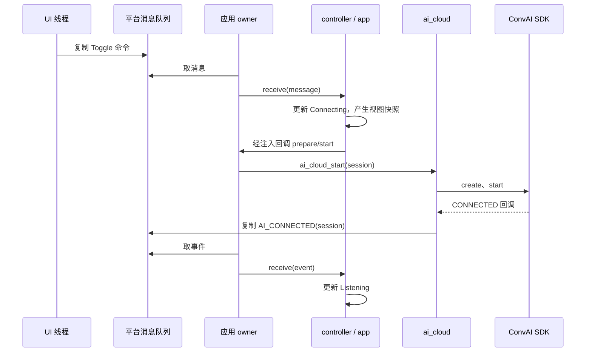

# 第 4 步：追踪 Start、Stop 与界面更新

[培训索引](README.md) · [上一步](03-core-and-controller.md) · [下一步](05-audio-pipeline.md)

## 1. 学习目标

把 UI、平台队列、controller、状态机和云服务连接起来，能沿着实际函数回答“点击 Start 后，谁调用了谁”。本节只跟踪控制链路，音频字节流留到下一节。

源码入口：[公共 LVGL 页面](../../src/application/ui/ai_lvgl.c)、[ESP 入口](../../src/platforms/esp_idf/entry/app_main.c)、[GoldieOS 入口](../../src/platforms/goldieos/entry/app.c)、[公共云接入](../../src/application/services/cloud/ai_cloud.c)。

## 2. 一次点击不是一次 SDK 调用

公共页面里的 toggle 回调只执行 `on_command(AI_UI_TOGGLE)`，并不直接调用 `convai_start`。页面负责表达用户意图，平台负责把意图送入应用 owner。

ESP 路径：`toggle → ui_command → enqueue → FreeRTOS events 队列`。

GoldieOS 路径：`toggle → 平台 UI 的 command → ws_command → enqueue → mutex 保护的 events 数组`。

两条路径最终形成 `ai_message_t`，kind 为 COMMAND，command 为 TOGGLE。消息以值复制进入队列，不能把 UI 栈上临时对象的地址当作稍后可用的消息。



箭头跨越线程时，图中明确通过队列；controller/app 的同步函数仍在 owner 上执行。SDK 回调不要求与 UI 或 owner 同线程。

## 3. Start 的逐函数阅读路线

1. `ai_controller_receive` 识别命令，调用 `ai_controller_command`。
2. command 转换为 `AI_TOGGLE`，交给 `ai_app_dispatch`。
3. 若当前不活动且 network_up，app 建立新 session、清 error、设置 Connecting，并先 render。
4. app 通过 ops.start 调用 controller 的 start 包装。
5. controller 检查时间、调用 prepare，随后调用 session.start。
6. 平台 start 包装先将 session 交给媒体，再进入 `ai_cloud_start`。
7. cloud 创建 SDK 实例、打开接收门控、允许媒体上传，并调用 `convai_start`。
8. SDK 的 CONNECTED 回调设置 connected 并排队 `AI_CONNECTED`；owner 处理后才更新 Listening。

初次页面点击实际是 Toggle；应用接口还支持显式 Start 和 Stop，不能把二者的重复调用语义混淆。

## 4. prepare 为什么每次执行

平台 prepare 组装 `ai_cloud_config_t`：配置 JSON、agent、启动参数、媒体 ops 和事件投递函数。然后调用 `ai_cloud_init`。

启动阶段先准备一次可以及早发现配置问题，Start 前再准备使失败后有重试机会。这里不是在点击时从头初始化所有驱动，也不是每次都重新创建 LVGL 页面。

[ai_cloud.h](../../src/application/services/cloud/include/ai_cloud.h) 约定配置指针在应用生命周期内有效。结构体复制不等于复制它指向的字符串，不能把临时局部 JSON 缓冲地址交给 cloud 后立即释放。

## 5. cloud 中的几个布尔量

| 变量 | 控制的内容 |
|---|---|
| `accepting` | 是否继续接受当前会话回调/上传处理 |
| `connected` | SDK 是否报告连接成功 |
| `playback_allowed` | 是否允许当前下行音频进入媒体 |
| `answering` | 是否已经处于本轮回答，用于避免重复 ANSWERING 清空播放 |

这些变量是原子变量，用来跨执行上下文传递门控状态；它们不是可以随意绕过 stop/destroy 的替代品。

`send_audio` 在尚未接入时返回 +1，表示暂时暂停，不等于上传失败；调用返回成功也不表示云端已经识别内容。

## 6. UI 怎样安全地更新

公共 core 通过 render 输出 `ai_view_t`。平台实现先复制状态，UI 自己的线程稍后调用公共 `ai_lvgl_render` 更新控件。

阅读 [ESP 平台 UI](../../src/platforms/esp_idf/components/ui/ai_ui.c) 和 [GoldieOS 平台 UI](../../src/platforms/goldieos/components/ui/ui.c)：ESP 通过队列传递视图更新，GoldieOS 使用锁保护快照及 dirty 标志，最终均由 UI 循环操作控件。

GoldieOS 还通过 App_t 注册 show/hide/touch/key 回调。hide 会请求 Stop；触摸事件更新坐标，由 LVGL 输入回调读取。`application/ui` 决定布局，平台 UI 负责将系统事件接入 LVGL。

Start 按钮的视觉状态与会话状态相关，但 UI 文案不是底层链路的直接仪表。例如显示 Speaking 只表示收到相应业务事件，不保证扬声器持续有音频。

## 7. Stop 的实际顺序

从 `ai_app.c` 的 stop 开始看：先设 inactive 并推进 session，使旧事件失效；若之前 active，调用平台提供的 stop；根据错误和网络状态决定 Error/Ready/Offline。

`ai_cloud_stop` 的主要步骤：

```text
关闭 accepting、connected、playback_allowed
  → media.enable(false)：完成上传停止屏障
  → media.reset：丢弃旧播放
  → convai_stop
  → convai_destroy，释放 engine
  → 再执行 enable(false) 和 reset
```

第二次媒体清理用于覆盖销毁前已经开始执行的回调副作用。接口约定 SDK 销毁返回前应完成回调线程退出；若底层实现不满足，单靠 session 编号不足以防止资源竞态。

SDK 失败回调会关门控、reset 并投递事件，应用 owner 后续负责完整 stop。不能在任意 SDK 回调线程中直接销毁自己依赖的 SDK 线程或对象。

## 8. 常见分支

| 情况 | 当前处理 |
|---|---|
| 离线点击 Start | 不开始会话 |
| 网络在线但时间未就绪 | controller 返回 -8 |
| create/start 失败 | 返回失败，状态机执行停止清理 |
| 点击 Wi-Fi | 公共 controller 先停止，再请求平台配网 |
| 消息队列满 | 平台标记溢出，owner 清队列，再产生 -9 |
| 云端回答发送完 | 标记媒体 finish，不直接由该事件切换为 Listening |

最后一条是为了给播放缓存留出消费时间；其他 SDK Listening 状态仍会转换成 AI_HEARING，不能断言界面只可能通过排空事件进入 Listening。

## 9. 阅读练习

给函数标注执行上下文：公共 toggle、平台 enqueue、ai_app_dispatch、SDK on_audio、ai_lvgl_render。

参考：toggle 在 UI 上下文；enqueue 在调用者上下文并使用队列同步；dispatch 在应用 owner；on_audio 在 SDK 回调上下文；ai_lvgl_render 在平台 UI 所有者线程。

追问：如果为了“少跳几层”，从公共按钮回调直接调用 `convai_start`，失去了什么？答案包括统一前置检查、会话编号管理、owner 串行化、错误清理和平台替换边界。

完成本节后，应能用两种颜色画图：一种画同步函数调用，另一种画队列或快照跨线程交付。
