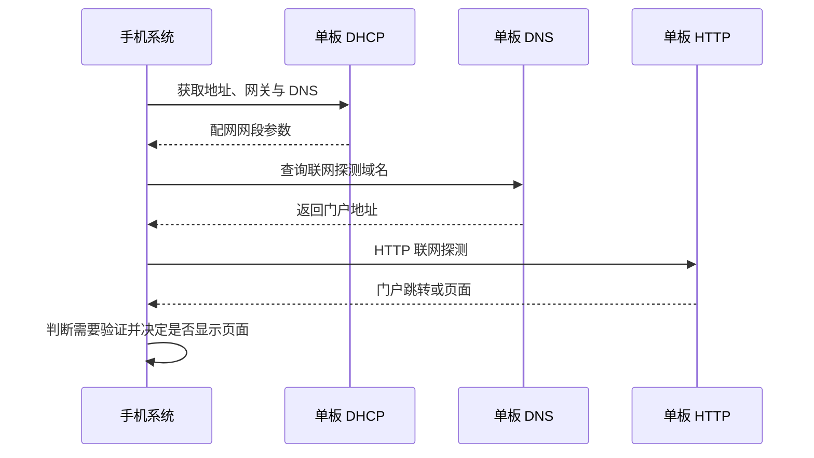

# 第 6 步：Wi-Fi 配网、门户与存储

[培训索引](README.md) · [上一步](05-audio-pipeline.md) · [下一步](07-platforms-and-boards.md)

## 1. 学习目标

区分手机页面、单板扫描、单板连接路由器和保存配置；理解自动弹出页面为何涉及 DHCP、DNS、HTTP；能定位网络业务与平台实现的边界。

本节讲当前热点加手机网页方案。直接在单板 LVGL 页面选择网络和输入密码尚未实现，不应从“共用 UI”推导出该功能已经存在。

## 2. 四个参与方

| 参与方 | 做什么 |
|---|---|
| 用户手机 | 连接单板热点、运行网页、输入凭据、发出 HTTP 请求 |
| 单板配网服务 | 扫描 Wi-Fi、连接路由器、存储网络、返回页面和结果 |
| 家用/办公路由器 | 提供单板之后要使用的网络接入 |
| 云服务 | 对话能力；不负责替单板扫描附近 Wi-Fi |

扫描结果由单板无线硬件与驱动提供。网页只是发送 `/scan` 请求并展示 JSON。WS63 请求处理会启动扫描并等待结果；ESP 当前返回后台扫描维护的结果缓存，不是每次 HTTP 请求都重新扫描。它们都不是浏览器读取手机系统的 Wi-Fi 列表。

## 3. 源码从网页往下读

1. [wifi_configuration.html](../../src/application/ui/web/wifi_configuration.html)：按钮、api、scan、connectNetwork 和保存列表。
2. [ai_provision.h](../../src/application/services/network/include/ai_provision.h) 与 [实现](../../src/application/services/network/ai_provision.c)：参数及 HTTP 头校验。
3. [ai_wifi_store.c](../../src/application/services/network/ai_wifi_store.c)：公共列表变更和 save 回调。
4. [ESP network.cpp](../../src/platforms/esp_idf/components/network/network.cpp)：联网与配置模式切换。
5. [ESP 配网服务](../../src/platforms/esp_idf/components/network/esp-wifi-connect/wifi_configuration_ap.cc)：HTTP 接口和扫描连接实现。
6. [WS63 network.c](../../src/platforms/goldieos/components/network/ws63/network.c)：热点、HTTP/DNS 任务、连接和保存。

两个后端服务同一套 HTML 和公共规则，但并没有把所有 HTTP 服务端、无线 API 或线程实现合并成一份代码。

## 4. 启动与手动配网

当前保留启动后的自动联网/配网：有保存网络时尝试连接；没有保存网络或一定时间未连上时进入配置热点。ESP 与 WS63 均有约 30 秒未连上的回退判断，具体任务调度和重试方式不同。

Wi-Fi 按钮用于主动进入配网。调用链为 `UI → PROVISION 命令 → controller 先停止会话 → 平台 provision`。

WS63 `ws_network_provision` 设置请求标志，由 network_task 执行后续操作；并不是 UI 线程直接创建热点。配置模式期间不把设备报告成可直接开始 AI 会话，即使 STA 侧已经临时连上路由器。

## 5. 手机自动弹窗的链路



自动弹窗由手机系统策略决定；单板通过正确的网络参数和探测响应提供触发条件。HTTP 门户不是 HTTPS 解密，也不能对所有系统状态保证强制弹窗。

公共 [ai_portal.c](../../src/application/services/network/ai_portal.c) 处理受支持的 DNS 查询包；A 查询返回门户 IPv4，其他受支持的 IN 类型返回无答案。平台 DNS 任务负责实际 UDP 收发。

润和当前门户为 `http://192.168.4.1`。热点启动需先准备 HTTP/DNS，再启动 DHCP；否则手机拿到地址立即探测时可能遇到服务尚未就绪。

润和曾出现手动 IP 可打开、自动弹窗失败，修复涉及 DHCP 网关以及 DNS/启动顺序。相关兼容实现位于 [dhcp_gateway.c](../../src/platforms/goldieos/components/network/ws63/dhcp_gateway.c)、[portal_gateway.c](../../src/platforms/goldieos/components/network/ws63/portal_gateway.c)，它们属于当前 BSP 适配，不放进公共业务状态机。

## 6. 页面接口与含义

| 请求 | 当前用途 |
|---|---|
| `GET /scan` | 获取单板扫描结果：WS63 扫描等待，ESP 返回后台结果缓存 |
| `GET /saved/list` | 返回已保存网络名称列表 |
| `POST /submit` | 校验凭据、连接并保存 |
| `GET /connection/status?id=...` | WS63 已实现提交结果查询；当前 ESP 后端未实现该路由 |
| `GET /saved/delete?index=...` | 删除列表中的指定项 |
| `GET /saved/set_default?index=...` | 将指定项设为优先网络 |
| `POST /exit` | 退出配网，回到普通联网流程 |

这是当前实现的接口事实，不代表未来公共网络 API 必须沿用所有 HTTP 方法。不要擅自把索引等同于 SSID 或永久设备身份；列表变化后索引也可能变化。

## 7. “连接并保存”的完整过程

以 WS63 `handle_http` 的 `/submit` 分支为例：

```text
解析 SSID、password、request_id
  → 校验凭据格式
  → connect_profile：扫描并调用板上 WLAN 连接
  → save_profile：调用公共列表操作及 NV 后端
  → 保存本次结果供 status 查询
  → 返回 success 或具体失败原因
```

无线连接成功与保存成功是两个条件。当前会区分连接失败、内部存储写入失败和整体成功；设备已连路由器但保存失败时，不能对用户显示“网络已保存”。

成功后公共页面显示可以退出配网；当前 `/submit` 成功并不在该分支立即拆除热点。退出由 `/exit` 触发，之后平台恢复普通联网流程。手机弹窗自行关闭也不等于应用已收到 `/exit`。

## 8. Failed to Fetch 与结果核对

AP 与 STA 并行工作时，连接路由器可能带来信道变化，手机与热点的 HTTP 链路会短暂中断。浏览器报 Failed to Fetch 说明没拿到有效传输结果，不足以证明设备连接操作失败。

公共网页给提交附上 request_id；遇到传输异常时尝试查询 `/connection/status`，以免立即重复提交凭据。这个机制用于有限的结果核对，不是保证所有请求永久幂等：WS63 只保留当前最近一次结果，重启后不会保留该结果。

当前 ESP 的 wifi_configuration_ap.cc 没有实现该状态查询路由，也没有按 request_id 保存结果。因此共用网页不代表这条恢复能力已经在两平台拉齐；ESP 在传输异常后可能进入“无法确认结果”的提示分支。本教材如实记录差异，本轮没有修改平台实现。

当前首次配网偶发断连仍是已知问题，不能因为存在重试逻辑就宣称所有情况已解决。

## 9. 保存规则与介质后端

公共 `ai_wifi_store_*` 负责增删与顺序调整，调用 `ai_wifi_store_ops_t.save` 后，成功才发布新的 RAM 列表。平台决定实际持久化格式、提交和回读。

| 平台 | 存储后端 | 阅读入口 |
|---|---|---|
| ESP | NVS 双快照，兼容旧数据读取 | [esp_wifi_store.c](../../src/platforms/esp_idf/components/network/esp-wifi-connect/esp_wifi_store.c) |
| WS63 | 内部 NV 双快照及校验，不依赖 SD 卡 | [wifi_store.c](../../src/platforms/goldieos/components/network/ws63/wifi_store.c) |

“保存返回失败、RAM 未更新”不保证介质一个字节都没改变：写成功但回读失败时，重启可能读取新值。断电恢复能力要结合后端实现和测试说明，不能只看公共 save 返回值。

## 10. 模拟器与网络状态

[Windows network.c](../../src/platforms/goldieos/components/network/windows/network.c) 使用电脑网络状态查询，没有创建配置热点。它的在线判断也不保证云服务地址可达。

平台将内部网络状态转换成公共 `ai_network_status_t`，再经 [ai_network_format](../../src/application/services/network/ai_network_status.c) 生成文字。界面不应直接依赖 ESP 的 Wi-Fi 对象或 GoldieOS 的 WifiService 类型。

## 11. 练习与参考答案

1. 手机页面扫描不到网络，应先查手机扫描权限吗？本项目先查单板 `/scan`、无线驱动及响应。
2. IP 可打开而域名不可打开，优先检查哪一段？DNS 地址下发及 DNS 服务；这只缩小范围，不是最终根因。
3. 能连接但重启丢失网络，应看哪里？先查保存返回值、平台持久化和启动加载，不先改 UI。
4. 想支持新的存储芯片，是否重写公共删除网络逻辑？通常只替换后端，保留公共列表规则。

课堂可以对照浏览器请求和单板日志画时序，但不要记录真实密码、POST 正文或云鉴权。
